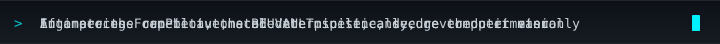
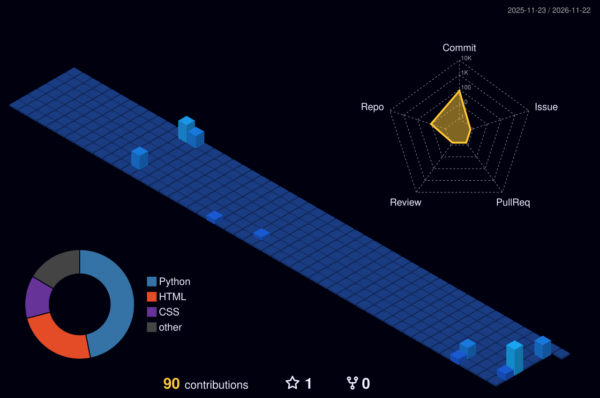

  <!-- ============================================== -->
  <!-- 🛰️ MINIMALIST ARCHITECTURAL BANNER (INSPIRED BY LXLYNX) -->
  <!-- ============================================== -->
  

  <!-- ============================================== -->
  <!-- ⚡ CYCLING PHILOSOPHY & TERMINAL PROMPT        -->
  <!-- ============================================== -->
  

    
  

  <!-- ============================================== -->
  <!-- 🪐 CORE TECH BADGES & PROTOCOL ROOMS          -->
  <!-- ============================================== -->
  

    
    
    
    
    
    
    
    
    &nbsp;&nbsp;
    
    
    
  

---

### 📡 ✦ System Topology & Architecture

  

---

### 🚀 ✦ Core Engineering Flagships

<table>
  <tr>
    <td width="50%" valign="top">
      <h3 align="center">👾 ✦ FormPilot</h3>
      
<b>AI Cyber Bhaiya — Autonomous Browser Agent</b>

      <ul>
        <li><b>Autonomous Operations:</b> Multi-agent browser operator executing complex examination &amp; registry form workflows.</li>
        <li><b>Deterministic Sandboxing:</b> Playwright execution with automated human-in-the-loop fallback and state verification.</li>
        <li><b>Tech Stack:</b> <code>Playwright</code>, <code>FastAPI</code>, <code>React 19</code>, <code>Vite</code>, <code>Pydantic</code>, <code>Cryptography</code></li>
      </ul>
      

        <a href="https://github.com/Nishant-learns/formpilot"><b>Inspect Repository ➜</b></a>
      

    </td>
    <td width="50%" valign="top">
      <h3 align="center">🏛️ ✦ BEUVAULT (Core / Launch)</h3>
      
<b>University Academic Platform &amp; Analytics Engine</b>

      <ul>
        <li><b>Institutional Ingestion:</b> High-throughput extraction and analytics platform for university engineering results.</li>
        <li><b>Automated Reporting:</b> Dynamic academic transcripts, rank synthesis, and historical grade performance tracking.</li>
        <li><b>Tech Stack:</b> <code>FastAPI</code>, <code>Python</code>, <code>Render</code>, <code>PDF Engines</code>, <code>Gunicorn</code></li>
      </ul>
      

        <a href="https://github.com/Nishant-learns/BEUVAULT"><b>Inspect Repository ➜</b></a>
      

    </td>
  </tr>
  <tr>
    <td width="50%" valign="top">
      <h3 align="center">🔮 ✦ BEUVAULT Predict</h3>
      
<b>AI Academic Dossier &amp; Forecasting Engine</b>

      <ul>
        <li><b>Predictive Intelligence:</b> Machine learning &amp; vector heuristics to forecast course performance and generate student dossiers.</li>
        <li><b>Vector Synthesis:</b> Syllabus metadata indexing paired with Next.js 16 modern edge SSR rendering.</li>
        <li><b>Tech Stack:</b> <code>Next.js 16</code>, <code>TypeScript</code>, <code>Supabase</code>, <code>Transformers</code>, <code>Tailwind CSS</code></li>
      </ul>
      

        <a href="https://github.com/Nishant-learns/beuvault-predict"><b>Inspect Repository ➜</b></a>
      

    </td>
    <td width="50%" valign="top">
      <h3 align="center">⚡ ✦ BEU-OS Watcher Daemon</h3>
      
<b>Real-Time Result Ingestion &amp; Push Alerts</b>

      <ul>
        <li><b>Autonomous Daemons:</b> 24/7 background watchers actively detecting university result publications with state-diffing logic.</li>
        <li><b>Instant Telemetry:</b> Microsecond push notifications via automated messaging bots and asynchronous event queues.</li>
        <li><b>Tech Stack:</b> <code>Python</code>, <code>Docker</code>, <code>Async Scraping</code>, <code>Telegram Bot API</code>, <code>Linux</code></li>
      </ul>
      

        <a href="https://github.com/Nishant-learns/beu-os-notification"><b>Inspect Repository ➜</b></a>
      

    </td>
  </tr>
</table>

---

### 🕹️ ✦ Contribution Matrix & Activity Arena

  <h4>🌌 ✦ 3D Isometric Night-View Skyline</h4>
  
<i>Isometric 3D city landscape rendered daily from repository commit density</i>

  

    

  <h4>🐍 ✦ Autonomous Contribution Snake</h4>
  
<i>Autonomous arcade snake traversing git contributions in real-time</i>

  <picture>
    <source media="(prefers-color-scheme: dark)" srcset="https://raw.githubusercontent.com/Nishant-learns/Nishant-learns/output/github-contribution-grid-snake-dark.svg">
    <source media="(prefers-color-scheme: light)" srcset="https://raw.githubusercontent.com/Nishant-learns/Nishant-learns/output/github-contribution-grid-snake.svg">
    
  </picture>

---

### 🛠️ ✦ Capabilities & Tech Arsenal

<table>
  <tr>
    <td align="right" width="22%"><b>✦ Languages</b></td>
    <td>
      
    </td>
  </tr>
  <tr>
    <td align="right"><b>✦ Frameworks &amp; Vision</b></td>
    <td>
      
    </td>
  </tr>
  <tr>
    <td align="right"><b>✦ Data &amp; Infrastructure</b></td>
    <td>
      
    </td>
  </tr>
  <tr>
    <td align="right"><b>✦ Tooling &amp; Hardware</b></td>
    <td>
      
    </td>
  </tr>
</table>

---

### 📊 ✦ Live Telemetry & Global Metrics

  <!-- Activity Graph (Rendered directly from repository asset - 100% Visible & Resilient) -->
  <h4>📈 ✦ Commit Trajectory &amp; Velocity</h4>
  

    

  <!-- Live Streak Statistics -->
  

---

### 🎮 ✦ Interactive Transmission & Mission Dispatch

| Protocol | Action Request | Direct Dispatch Link |
| :---: | :--- | :---: |
| 🚀 | **Initiate AI / Systems Collaboration** | [**`[ OPEN COLLAB TICKET ]`**](https://github.com/Nishant-learns/Nishant-learns/issues/new?title=%F0%9F%9A%80%20Mission%20Collaboration%20Inquiry&body=%E2%9A%A1%20Hey%20Nishant,%20I'd%20love%20to%20collaborate%20on...) |
| 🛡️ | **Report Security Observation / Vector** | [**`[ DISPATCH ADVISORY ]`**](https://github.com/Nishant-learns/Nishant-learns/issues/new?title=%F0%9F%9B%A1%EF%B8%8F%20Security%20Observation&body=%F0%9F%94%92%20Security%20observation%20details...) |
| 🪐 | **Star Sentinel Station Repository** | [**`[ SYNC REPO STAR ⭐ ]`**](https://github.com/Nishant-learns/Nishant-learns) |

---

  ⚡ ✦ Engineered with precision &amp; autonomous intelligence by <b>Nishant</b> ✦ ⚡

